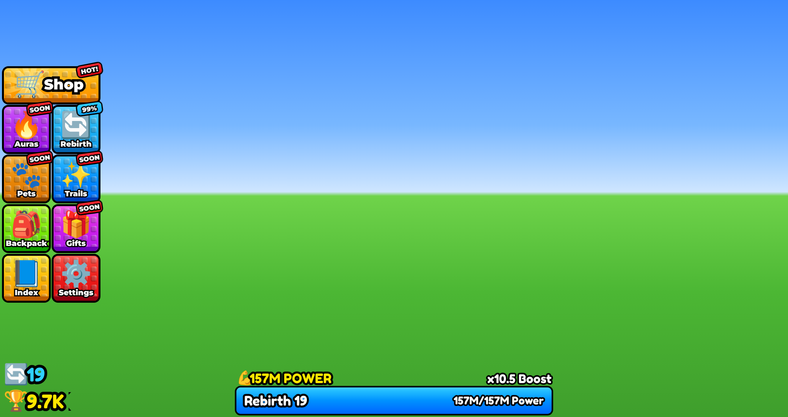
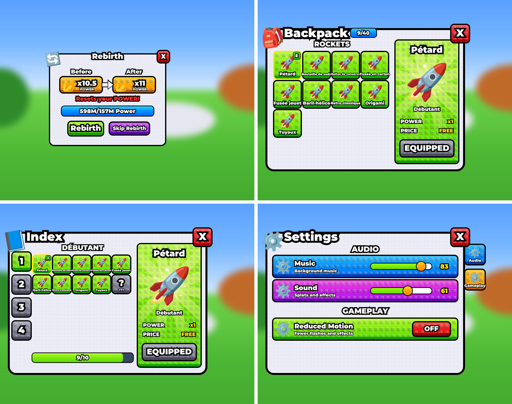

# Interface « pixel cubique » (HUD)

L'interface reprend la disposition de la capture de référence : la colonne de 9 boutons à gauche (Shop, Auras,
Rebirth, Pets, Trails, Backpack, Gifts, Index, Settings), les compteurs en bas à gauche (rebirths, wins) et la
barre de puissance en bas au centre (« 157M POWER », « x10.5 Boost », « Rebirth 19 … 157M/157M Power »).

Les boutons ouvrent des **fenêtres** comme dans la vidéo de référence : Rebirth, Backpack, Index et Settings.





*Maquette web construite avec les mêmes proportions que le code Luau, avec des emojis à la place des icônes.
Dans Roblox, le rendu peut légèrement différer.*
Animations : survol et clic [`assets/ui/apercu_survol.gif`](../assets/ui/apercu_survol.gif), fenêtres
[`assets/ui/apercu_fenetres.gif`](../assets/ui/apercu_fenetres.gif).

## Les trois effets demandés

| Effet | Ce qui se passe | Où c'est codé |
|---|---|---|
| **Pixel cubique** | Chaque bouton est couvert d'une grille de petits cubes en relief (éclairés en haut à droite, ombrés en bas à gauche) qui prennent la couleur du bouton. Au clic, une gerbe de petits cubes contourés jaillit de l'icône. | `PixelFx.studs`, `PixelFx.cubeBurst` |
| **Brillant** | Un reflet blanc incliné traverse chaque bouton toutes les 3,5 à 7 s (décalé d'un bouton à l'autre), et immédiatement au survol. Des étincelles scintillent autour des icônes. Des rayons lumineux tournent derrière l'icône du Shop. La barre bleue a aussi son reflet, plus fréquent quand elle est pleine. | `PixelFx.shine`, `PixelFx.sparkle`, `PixelFx.rays` |
| **L'icône bouge au survol** | Le bouton grossit un peu, l'icône se soulève, grossit, se balance de gauche à droite et flotte de haut en bas tant que la souris reste dessus. Elle revient en place en rebondissant quand la souris part. Sur téléphone (pas de souris), l'icône bouge quand on touche le bouton. À la manette, elle bouge quand le bouton est sélectionné. | `PixelButton.luau` (`setHover`) |

## Les fenêtres (comme dans la vidéo)

| Bouton | Ce qui s'ouvre |
|---|---|
| **Rebirth** | « Before » x10.5 POWER ➜ « After » x11 POWER, « Resets your POWER! », barre « 598M/157M Power », boutons **Rebirth** (vert) et **Skip Rebirth** (violet) |
| **Backpack** | Compteur « 9/40 » à côté du titre, grille de tes fusées (couleur du monde, « E » vert sur celle équipée), fiche à droite avec rayons, POWER, PRICE et **EQUIP** |
| **Index** | Onglets des 4 mondes à gauche, toutes les fusées du monde (celles pas débloquées en silhouette « ??? »), barre de collection, fiche avec bouton d'achat « 150 Wins » |
| **Settings** | AUDIO : curseurs **Music** et **Sound** ; GAMEPLAY : **Reduced Motion** OFF/ON (coupe reflets, étincelles, cubes et animations) ; onglets Audio / Gameplay à droite |
| Auras, Pets, Trails, Gifts, Shop | Message « Trails coming soon! » en haut de l'écran |

Animation : la fenêtre jaillit en rebondissant (75 % → un peu plus de 100 % → 100 %) pendant que le décor 3D
se floute ; le X rouge (ou un nouveau clic sur le bouton) la referme en rétrécissant. Une seule fenêtre à la
fois : ouvrir Index ferme Backpack. Le badge du Rebirth devient **READY** (vert, qui pulse) quand la Power
suffit.

Dans Backpack et Index, l'aperçu d'une fusée est son **modèle 3D** s'il est rangé dans
`ReplicatedStorage > Assets > Rockets` sous sa clé (voir `docs/02-import-fusees-roblox.md`), sinon une icône 🚀.

Pour un fond de fenêtre identique à la vidéo (petites briques), importe
`assets/ui/textures/brick_tile.png` comme les icônes et colle son ID dans `Hud.Panel.BrickTile`. Sans ça, un
quadrillage léger construit en code le remplace.

Autres détails repris de la capture : contour noir épais, dégradé de couleur, rebord 3D sombre en bas des
boutons, badges rouges penchés « HOT! » / « SOON » qui se balancent, badge bleu « 99% » sur Rebirth (calculé
automatiquement et qui pulse à 100 %), nombres abrégés (9.7K, 157M) qui défilent quand ils changent.

## Installer l'interface

### Avec Rojo

Rien à faire : `default.project.json` place déjà les fichiers.

| Fichier | Rôle | Dans Studio |
|---|---|---|
| `src/shared/Config/Hud.luau` | **Configuration** : icônes, textes, couleurs, badges, disposition | `ReplicatedStorage.Shared.Config.Hud` |
| `src/shared/Util/FormatNumber.luau` | 9721 → 9.7K, 157000000 → 157M | `ReplicatedStorage.Shared.Util.FormatNumber` |
| `src/client/UI/PixelFx.luau` | Effets : cubes, reflet, rayons, étincelles, textes contourés | `StarterPlayerScripts.Client.UI` |
| `src/client/UI/PixelButton.luau` | Un bouton (survol, clic, badge) | `StarterPlayerScripts.Client.UI` |
| `src/client/UI/StatsHud.luau` | Compteurs du bas et barre de puissance | `StarterPlayerScripts.Client.UI` |
| `src/client/UI/PixelPanel.luau` | Fenêtre : fond en briques, titre, X, ouverture en rebond + flou | `StarterPlayerScripts.Client.UI` |
| `src/client/UI/Panels/*.luau` | Fenêtres Rebirth, Settings, Backpack / Index | `StarterPlayerScripts.Client.UI.Panels` |
| `src/client/Controllers/HudController.luau` | Construit l'écran, l'adapte à la taille, lit les valeurs du joueur | `StarterPlayerScripts.Client.Controllers` |
| `src/client/Main.client.luau` | Démarre l'interface | `StarterPlayerScripts.Client.Main` (LocalScript) |

### Sans Rojo (un seul script à coller)

1. Dans Studio : **StarterPlayer → StarterPlayerScripts → + → LocalScript**, renomme-le `PixelHud`.
2. Ouvre `tools/ui/PixelHud.standalone.client.luau`, copie **tout** le contenu et colle-le dans ce LocalScript.
3. Clique **Play**. Au bout de 4 secondes, si ton jeu n'a pas encore de `leaderstats`, l'interface affiche les
   valeurs de la capture (mode démo).

La configuration (icônes, textes, couleurs) est **tout en haut** du script, dans la section `CONFIGURATION`.
Pour brancher les boutons, ajoute ton code **tout en bas**, après `HudController.Start()`.
Ce fichier est généré : si tu modifies les fichiers de `src/`, relance `python3 tools/ui/build_standalone.py`.
Utilise **l'une ou l'autre** version (Rojo ou script unique), pas les deux en même temps.

## Mettre tes images à la place des emojis

1. Prépare chaque icône en **PNG à fond transparent**, carré (512 × 512 conseillé), avec son contour noir déjà
   dessiné, comme sur la capture. Tu peux m'envoyer tes images : je les détoure, les recadre et les exporte.
2. Importe-les dans Roblox depuis Studio : ouvre l'**Asset Manager** (menu View ou Window selon ta version de
   Studio) → bouton **Import** → sélectionne tes PNG. Attends la modération.
3. Dans l'Asset Manager, clic droit sur chaque image → **Copy ID to Clipboard**. N'utilise pas l'ID d'un
   *Decal* : c'est un autre numéro que celui de l'image, l'icône resterait vide.
4. Dans la configuration, colle l'ID dans le champ `image` du bouton :

```lua
{
	id = "Shop", label = "Shop", palette = "Amber", row = 1, col = 1, span = 2, rays = true,
	icon = { image = "rbxassetid://1234567890", emoji = "🛒" },
	badge = { text = "HOT!", palette = "BadgeRed", rotation = -8 },
},
```

Les icônes des compteurs du bas (rebirth, trophée, bras de la puissance) sont dans `Hud.StatIcons`.

## Brancher les boutons

Par défaut, Rebirth, Backpack, Index et Settings ouvrent leur fenêtre, et les autres affichent
« … coming soon! ». Les boutons **dans** les fenêtres envoient des actions que ton code écoute, depuis
n'importe quel script client (version Rojo) ou en bas du script unique :

```lua
local ReplicatedStorage = game:GetService("ReplicatedStorage")
local HudController = require(script.Parent.Controllers.HudController) -- chemin selon ton script

HudController.On("Rebirth", function()            -- bouton vert « Rebirth » (Power suffisante)
	ReplicatedStorage.Remotes.Rebirth:FireServer()
end)
HudController.On("SkipRebirth", function() end)    -- bouton violet (achat Robux par exemple)
HudController.On("Equip", function(rocketId) end)  -- EQUIP dans le Backpack
HudController.On("Buy", function(rocketId) end)    -- achat dans l'Index
HudController.On("Setting", function(name, value) end) -- "Music", "Sound", "ReducedMotion"

HudController.OnButton("Shop", function()          -- remplace l'action d'un bouton du menu
	print("ouvrir la boutique")
end)
```

Tant que personne n'écoute ces actions, le **mode démo** (dans Studio) les simule à l'écran : le rebirth
remet la Power à 0 et augmente le boost, EQUIP change la fusée équipée, l'achat débite les Wins.
Retire `comingSoon = true` (et le badge `SOON`) dans la configuration quand un menu est prêt.
Autres fonctions : `HudController.OpenPanel("Index")`, `HudController.Banner("Bravo !")`,
`HudController.GetButton("Rebirth").setBadge("NEW")`, `HudController.SetVisible(false)`.

## Brancher les valeurs du joueur

L'interface lit ce que ton script serveur range dans le joueur :

| Valeur | Où | Type |
|---|---|---|
| Wins | `player.leaderstats.Wins` | IntValue ou NumberValue |
| Rebirths | `player.leaderstats.Rebirths` | IntValue ou NumberValue |
| Power | `player.leaderstats.Power` | IntValue ou NumberValue |
| Boost (x10.5) | `player:SetAttribute("Boost", 10.5)` | nombre |
| Power nécessaire au prochain rebirth | `player:SetAttribute("RebirthCost", 157400000)` | nombre |
| Boost après le prochain rebirth (« After ») | `player:SetAttribute("NextBoost", 11)` | nombre |
| Fusées possédées (Backpack, Index) | `player:SetAttribute("OwnedRockets", "1,2,5")` | texte |
| Fusée équipée (« E » vert) | `player:SetAttribute("EquippedRocket", 1)` | nombre |

Si `RebirthCost` n'est pas posé, la formule provisoire `Hud.RebirthCost` est utilisée : remplace-la par la
tienne (pareil pour `Hud.NextBoost`). Le badge du bouton Rebirth affiche `Power / RebirthCost` en
pourcentage, puis READY. Le mode démo (valeurs de la capture) ne s'active que **dans Studio** et seulement
si `leaderstats` n'existe pas au bout de 4 secondes ; pour le couper : `Hud.Demo.Enabled = false`.

## Réglages utiles (`Hud.Style` et `Hud.Layout`)

| Réglage | Effet |
|---|---|
| `HoverScale`, `IconHoverScale`, `IconWiggle` | Grossissement du bouton, de l'icône, angle du balancement au survol |
| `ShineEvery`, `SparkleEvery` | Fréquence des reflets et des étincelles automatiques |
| `StudPitch`, `StudSize` | Taille et espacement des cubes en relief |
| `OutlineCells`, `CornerCells`, `LipCells` | Épaisseur du contour, arrondi, hauteur du rebord 3D |
| `LabelCells`, `WideLabelCells` | Taille des textes des boutons |
| `Layout.HeightOfScreen` / `HeightOfScreenSmall` | Hauteur de la colonne (écran normal / téléphone) |
| `Hud.Palettes` | Couleurs de chaque bouton (haut, bas, rebord) |

Pour ajouter un bouton, ajoute une entrée dans `Hud.Buttons` avec sa rangée (`row`) et sa colonne (`col`) :
la colonne se redimensionne toute seule.
